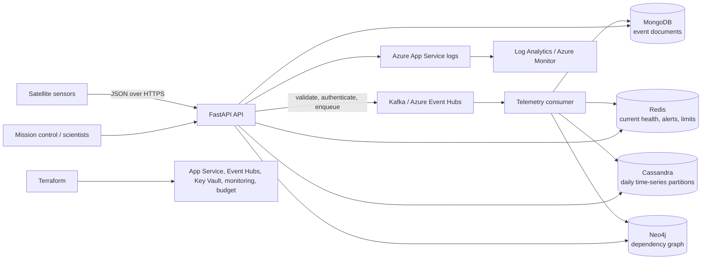

# Satellite Telemetry Data Platform — Capstone Report

## Executive summary

This capstone implements a cloud-ready telemetry platform that accepts JSON satellite readings, validates and durably queues them, projects each event into purpose-fit NoSQL models, and exposes secure APIs for recent health, history, dependencies, and alerts. The local reference deployment is reproducible with Docker Compose. Azure deployment supports Kafka-compatible Event Hubs; when external managed database endpoints are unavailable, demo mode substitutes in-memory projections and is not durable or multi-instance safe.

## Problem and requirements

Telemetry is high-volume, append-heavy, semi-structured, and queried in different ways by mission operators and scientists. The system must accept readings without waiting for every database write, support fast current-health lookups and bounded historical queries, alert on illustrative thresholds, and survive retries without losing acknowledged messages.

| Requirement | Reference implementation |
|---|---|
| Ingest validated sensor data | FastAPI `POST /v1/telemetry`; Pydantic schema rejects malformed payloads |
| Buffer/replay telemetry | Kafka; API responds after broker acknowledgement |
| Route readings to matching models | Background consumer writes MongoDB, Cassandra, Neo4j, and Redis |
| Serve telemetry and component queries | Versioned REST endpoints; Cassandra history is capped at 31 calendar days |
| Show an operator dashboard | Responsive static dashboard for login, telemetry submission, current health, recent alerts, and component links |
| Alert on threshold breaches | Temperature and battery voltage rules; recent alerts persisted in Redis |
| Protect mission operations | Short-lived HS256 bearer tokens, mission-control/scientist role checks, Redis rate limiting |
| Deploy repeatably | Compose for local development; Terraform for the Azure runtime foundation |
| Observe operations and cost | Structured logs/audit events to App Service/Log Analytics; Azure budget notifications |

The reference design does not claim a specific throughput or latency SLO. Those targets must be agreed and load-tested against the selected Azure region and managed database tiers before production.

## Architecture



### Component selection

| Component | Choice | Rationale and boundary |
|---|---|---|
| API/ingestor | Python 3.12, FastAPI | Async HTTP interface, strict request validation, OpenAPI |
| Broker | Kafka locally; Event Hubs Kafka endpoint in Azure | Separates acceptance from persistence, supports partition-based ordering and replay |
| Document store | MongoDB-compatible managed service | Flexible telemetry packet documents and indexed latest-by-sensor lookup |
| Key/value store | Redis-compatible managed service | Fast current status, expiring rate counters, and bounded recent-alert list |
| Wide-column store | Cassandra-compatible managed service | Partition-key-oriented writes and bounded timestamp scans for historical sensor data |
| Graph store | Neo4j-compatible managed service | Traverses satellite → module → sensor fault/dependency relationships |
| Compute | Azure App Service for Containers | Managed Linux container hosting with HTTPS ingress and health checks; B1 demo tier is a single instance |
| Secrets/identity | Azure Key Vault plus user-assigned managed identity | Runtime secret references avoid embedding secret values in the container image |
| Container registry | Azure Container Registry Basic | Private project registry; App Service pulls using managed identity, with admin credentials disabled |
| Observability | App Service diagnostic logs / Log Analytics; Azure budget | Captures service logs and sends configurable monthly spend threshold notices |

Relational storage remains useful for transactions and strongly constrained entities; it is not prohibited by this design. The multiple stores are justified only by distinct access patterns, and they introduce operational cost and eventual-consistency complexity.

## Data model

### Telemetry document

The source schema is [telemetry-packet.schema.json](../schemas/telemetry-packet.schema.json); the executable validation model lives in `src/mission_telemetry/models.py`.

```json
{
  "event_id": "f1100581-4602-4b90-a714-5c46f1a48a7a",
  "satellite_id": "SAT-001",
  "module_id": "power",
  "sensor_id": "temp-01",
  "metric": "temperature_c",
  "value": 97.2,
  "unit": "C",
  "observed_at": "2026-10-12T10:00:00Z",
  "sequence": 1
}
```

`event_id` is a caller-supplied or generated UUID used for idempotent projections. Timestamps require a timezone and normalize to UTC. Unknown fields, non-finite values, negative sequences, and invalid metric names are rejected.

### Store-specific schemas

- **MongoDB:** event document with stable `_id`; compound index `(satellite_id, sensor_id, observed_at DESC)`. Optimized for latest readings and flexible packet inspection.
- **Redis:** `health:{satellite_id}` hash field per `sensor_id`; 24-hour TTL. Alerts are kept in a bounded 1,000-item list with a 30-day TTL and deduplicated for seven days by deterministic alert ID. Per-IP rate counters expire after 60 seconds.
- **Cassandra:** `telemetry_by_sensor_day` partitioned by `((satellite_id, sensor_id, day_bucket))`, clustered by descending `observed_at` and `event_id`. Daily buckets bound partition growth and make historical reads explicit and bounded. See [cassandra.cql](../schemas/cassandra.cql).
- **Neo4j:** `(:Satellite {id})-[:CONTAINS]->(:Module {satellite_id,id})-[:HAS_SENSOR]->(:Sensor {satellite_id,id})`, with uniqueness constraints in [neo4j.cypher](../schemas/neo4j.cypher).

The model intentionally duplicates packet fields across stores to make each read/write path efficient. Store projections are not a distributed transaction; the broker is the replay source for reconciliation.

## Ingestion and alert processing

1. A mission-control principal sends a packet using HTTPS bearer authentication.
2. FastAPI enforces request schema, role authorization, and Redis-backed rate limits.
3. The producer keys Kafka records by satellite ID and waits for broker acknowledgement before responding `202 Accepted`.
4. A consumer validates the broker payload, writes the packet to the document and time-series stores, updates graph relationships and current health, evaluates rules, and persists any alert.
5. It commits the Kafka offset only after processing completes. Store failures are logged and retried; the message remains unacknowledged.

This is **at-least-once** processing. Stable event IDs make document and time-series writes replay-safe; graph `MERGE` is idempotent; alert IDs are deterministic and Redis `SET NX` deduplicates recent replays. A cross-store partial write can be visible until the replay succeeds. Invalid messages are explicitly logged and skipped in this demo; a production deployment should route them to a dead-letter topic and alert on its depth.

Illustrative rules (not flight-qualified limits):

| Metric | Warning | Critical |
|---|---:|---:|
| `temperature_c` | `>= 80 C` | `>= 95 C` |
| `battery_voltage_v` | `<= 20 V` | `<= 15 V` |

Thresholds should become reviewed, versioned per-satellite policy data before operational use.

## API and access controls

See [README API reference](../README.md#api) and the interactive `/docs` endpoint.

- `POST /v1/auth/token` exchanges one of two locally configured account/password pairs for a short-lived HS256 token.
- `mission-control` can enqueue packets; mission-control and `scientist` can query readings, dependencies, and alerts.
- Unauthorized callers receive 401; authenticated but unauthorized scientists receive 403 on ingestion.
- All `/v1` calls use an atomic Redis increment/expiry rate limit; health liveness is exempt.
- Login success/failure, denied role access, rate-limit events, and telemetry enqueue events are JSON audit log entries without passwords or raw sensor values.
- Production settings reject demo credentials, require Kafka SASL/TLS, TLS database endpoints, Cassandra credentials, and pre-applied Cassandra/Neo4j schemas.

Production follow-up: replace demo password authentication with Microsoft Entra ID/OIDC, provision separate per-service database credentials, restrict public networking, apply Key Vault least privilege, and retain audit logs according to mission policy.

## Cloud deployment, availability, and security

`terraform/` provisions an Azure resource group, Linux App Service, project-owned ACR, Event Hubs namespace/hub/consumer group, a least-purpose app identity, Key Vault-backed settings, App Service diagnostic settings, and a resource-group budget alert. Event Hubs is Kafka-compatible with SASL_SSL. The App Service plan uses West US 2 because this subscription has no B1 worker quota in West US; the supporting resources remain in West US. With no external database account credentials configured, the Azure deployment runs in demo mode and uses in-memory data projections for document, cache, wide-column, and graph access patterns. These projections are neither durable nor shared across instances; production requires provisioned MongoDB-compatible, Redis, Cassandra, and Neo4j services plus their secured endpoints.

The initial Terraform template uses one Event Hubs Standard throughput unit (auto-inflate ceiling two), a single B1 App Service instance, a Basic ACR, and 30-day log retention. Local Compose uses single-node databases, default-network plaintext, and a single Kafka broker: these are development settings, not HA/security settings. Production requirements include multi-zone database replication, backups/restore drills, TLS, private networking or narrow firewall rules, secrets rotation, schema migration review, database quotas, and load/chaos testing.

API console, HTTP, and platform logs are sent to Log Analytics through App Service diagnostic settings. Structured audit events, failed/slow HTTP requests (>=1 second), consumer failures, and slow data projections (>=1 second) use the same logging path without logging packet values or credentials. The responsive static dashboard at `/` surfaces health snapshots, alerts, graph relationships, and telemetry submission. A monthly Azure cost budget sends email alerts at 50%, 80%, and 100%; it does **not** cap or automatically stop spend.

## Cost forecast method

An accurate monthly price requires the target region, replication, steady/peak ingest rate, retention, query volume, log volume, and provider tiers. Do not interpret the sample `$100` Terraform budget as an estimate. Forecast with current regional pricing before deployment:

```text
Monthly total =
  App Service plan instances and runtime
  + Azure Container Registry storage and operations
  + Event Hubs throughput units and retention
  + Log Analytics ingestion and retention
  + Key Vault operations
  + MongoDB managed tier + storage + backup
  + Redis tier + memory/replicas
  + Cassandra-compatible tier + storage + replication
  + Neo4j managed tier + storage/backup
  + network egress, registry, DNS, and support charges
```

The first cost-control step is to run a measured representative load test, record each service's provisioned units and daily growth, then use Azure Cost Management/provider calculators to fill the equation for development, staging, and production. Set a budget above the expected baseline and configure separate forecasted/actual alerts.

## Monitoring and troubleshooting

- Broker or database unavailable at startup: the API fails startup explicitly; inspect Compose service health or App Service logs and validate network, credentials, TLS, firewall, and quotas.
- Growing broker lag: inspect Event Hubs/Kafka consumer lag, scale partitions and API consumers together, then check store write latency.
- Cassandra query validation: use the sensor/day-bucket partition; broad multi-sensor scans are intentionally absent.
- Missing alert: verify the metric spelling/unit, threshold, Kafka consumer progress, and Redis TTL/list retention.
- Replayed/partial projection: inspect the stable event ID in Kafka and MongoDB, then confirm Cassandra, Redis, and graph writes converge.
- Throttled caller: inspect `api.rate_limit_exceeded` audit events and adjust the Redis-backed per-minute policy deliberately.
- HTTP/server or projection latency: query App Service console logs in the linked Log Analytics workspace for `http.request_observed`, `http.request_failed`, or slow-projection messages. Add alert rules and dashboards in Azure Monitor using a measured service SLO.

## Trade-offs, limitations, and next improvements

1. Four database APIs raise operational complexity; use only stores whose distinct query needs are demonstrated.
2. The API acknowledges at Kafka, not after all projections, so read-after-write is eventually consistent.
3. A single background consumer blocks the partition on persistent store failure; production should add bounded exponential backoff, dead-letter routing, poison-message observability, and safe shutdown/draining.
4. Redis currently holds a short-lived cache and only the latest bounded alerts; durable alert history should move to an audit/event store.
5. Demo credentials and shared service accounts are only for the capstone; integrate OIDC and rotate least-privileged per-service identities.
6. Add integration/load tests for Cassandra partitioning, Kafka rebalances, datastore outages, concurrent replay, and recovery-time objectives.
7. Add policy-managed thresholds, sensor metadata, dead-letter replay tooling, and alert delivery (email/SMS/mission-control UI).
8. Add health/readiness checks for dependency degradation, dashboard queries, latency histograms, data-retention jobs, and backup/restore evidence.
9. Replace illustrative single-region/single-node choices with an approved multi-zone topology and measured cost/availability targets.

## Demo recording outline (10–15 minutes)

1. Introduce the high-rate, semi-structured satellite telemetry problem and its non-functional requirements.
2. Walk the architecture and justify document, key/value, wide-column, and graph models.
3. Show packet validation, UTC normalization, daily time-series partitioning, health keys, and graph schema.
4. Start the Compose stack and submit normal plus temperature/battery threshold packets.
5. Explore API docs, role-based 403 behavior, health snapshot, historical reading, dependency graph, and recent alerts.
6. Explain broker acknowledgement, retry/offset handling, event-ID deduplication, and eventual consistency.
7. Show Terraform, Key Vault references, Log Analytics, budget alerts, and the cost-estimation worksheet.
8. End with local-only limitations and the production hardening/test plan.
